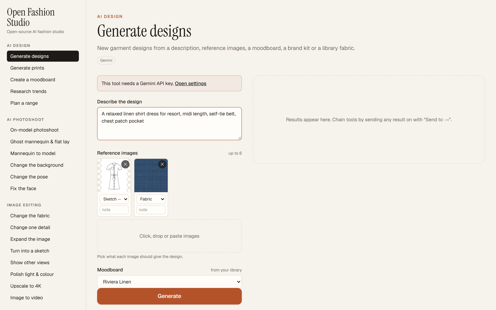
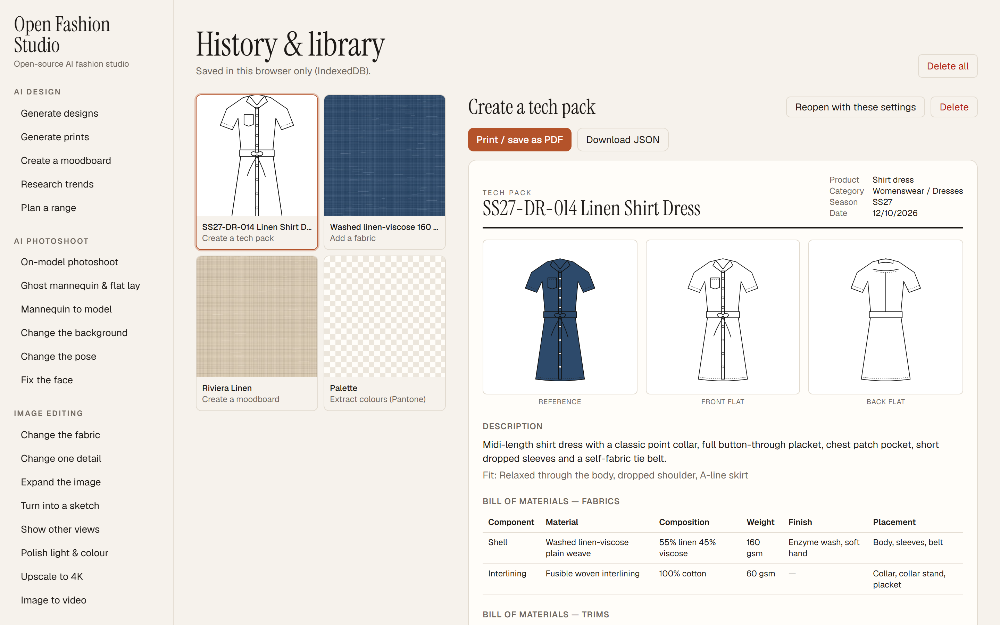
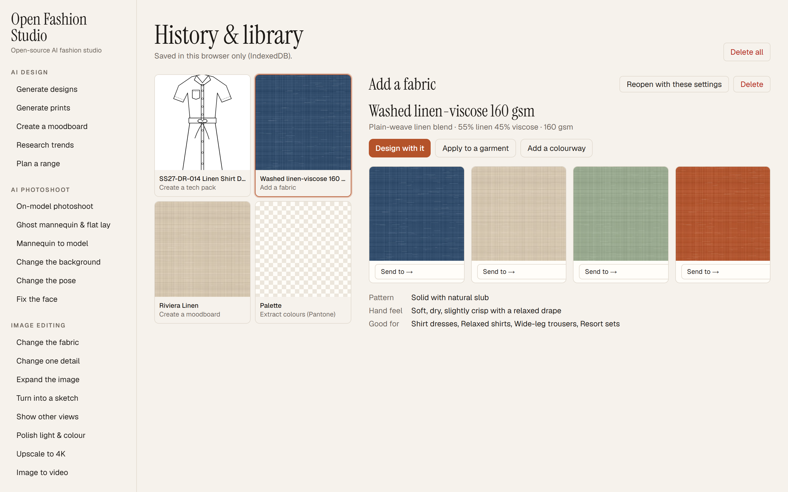
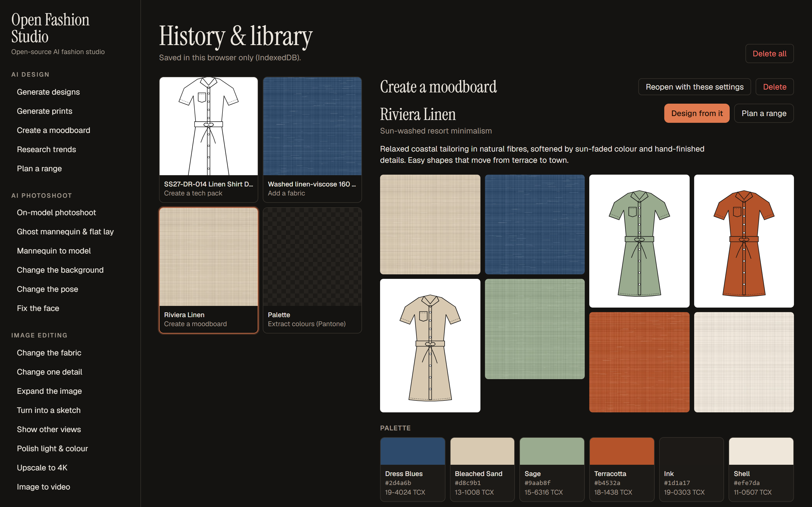

# Open Fashion Studio — open-source AI fashion design, photoshoots & tech packs

**Open Fashion Studio** is a free, open-source **AI fashion design tool** for designers, brands and manufacturers. Generate garment designs and textile prints, shoot your products on AI models, edit images, and turn a product photo into a **production-ready tech pack** — all in one browser app.

It is **bring-your-own-key (BYOK)**: plug in your own **Google Gemini** and **fal.ai** API keys and pay only what the providers charge. No subscription, no credits, no account, and no server sits between you and the models.

[](LICENSE)




## Features

29 tools in five groups. Every result can be sent into another tool with **Send to →**, so you can chain them: *sketch → design → on-model photoshoot → new background → 4K → video*.

### AI fashion design
- **Generate designs** from a text brief, up to 6 reference images (each tagged as garment, sketch, fabric, print, colour, style, pose, background or inspiration), a moodboard, a brand kit or a library fabric.
- **Generate prints**: seamless, repeatable textile patterns (straight, half-drop, mirror or tossed repeats).
- **Create a moodboard**: turn 3–16 images into a palette with Pantone TCX references, fabrics, prints, silhouettes, details and key items.
- **Research trends**: a trend report built from live Google Search results, with its sources.
- **Plan a range**: plan a collection line by line from a moodboard or brand kit and draw every piece — or isolate each garment from runway looks.

### AI product photoshoot
- **On-model photoshoot**: dress an AI model (gender, age, look, body type) in your product photos, in the poses and backgrounds you pick, optionally with a fixed face.
- **Ghost mannequin & flat lay**: invisible mannequin front/back, flat lay and detail close-ups.
- **Mannequin to model**: turn mannequin or worn photos into shots on a real-looking model, keeping the pose and framing.
- **Change the background** (preset scene, described scene, reference photo, library background or transparent PNG), **change the pose**, and **fix the face**.

### Image editing
Change the fabric of a garment · change one detail · expand / outpaint · turn into a technical flat, illustration or sketch · generate back and side views · polish light and colour · **upscale to 4K** · **image to video**.

### Tech pack generator
- **Create a tech pack** from a product photo: front and back technical flats, bill of materials (fabrics and trims), colours with Pantone references, construction details, stitch types (ISO 4915) with SPI, a measurement chart with tolerances, labels, care and open questions. **Print it to PDF** or export it as JSON.
- **Extract materials & trims**, **extract colours (Pantone)**, **extract the print** as a flat swatch, and **convert to SVG** for Illustrator and cutting.



### Library
Reusable records that other tools pick up from a dropdown:
- **Fabrics** with a clean swatch, fabric facts and as many **colourways** as you like.
- **Brand kits** that capture your brand DNA, so new designs stay on-brand.
- **Poses** and **backgrounds** saved from your own photos.

| Fabric library with colourways | Moodboard (dark mode) |
|---|---|
|  |  |

*Screenshots use illustrative sample data (hand-drawn flats and procedural fabric textures). Your results come from the models you connect.*

## Quick start

```bash
git clone https://github.com/serhatumutselet/open-fashion-studio.git
cd open-fashion-studio
npm install
npm run dev
```

Open http://localhost:3000, click **Settings & API keys** and add:

| Key | Used for | Get one |
|---|---|---|
| Google Gemini | Design, photoshoot, editing, analysis, trends, tech packs | [aistudio.google.com/apikey](https://aistudio.google.com/apikey) |
| fal.ai | Video, 4K upscaling, expanding, transparent backgrounds, SVG | [fal.ai/dashboard/keys](https://fal.ai/dashboard/keys) |

You can start with only a Gemini key; the tools that need fal.ai say so.

### Deploy

The app builds to static files (`npm run build`), so you can host it on Vercel, Netlify, Cloudflare Pages, GitHub Pages or any static host. No environment variables or backend are needed — each visitor uses their own keys.

## Models

| Job | Default model | Change it in |
|---|---|---|
| Image generation & editing | `gemini-3.1-flash-image` (Nano Banana 2); `gemini-3-pro-image` for top quality | Settings → Models |
| Image analysis, JSON specs, trend research | `gemini-3.8-flash` | Settings → Models |
| Image to video | `fal-ai/kling-video/v3/standard/image-to-video` | Settings → Models |
| 4K upscale | `clarityai/crystal-upscaler` | Settings → Models |
| Expand / outpaint | `fal-ai/bria/expand` | `src/lib/tasks/edit.ts` |
| Transparent background | `fal-ai/birefnet/v2` | `src/lib/tasks/photoshoot.ts` |
| Raster to SVG | `fal-ai/recraft/vectorize` | `src/lib/tasks/techpack.ts` |

## Privacy & security

- API keys are stored only in your browser (`localStorage`).
- Requests go **directly** from your browser to `generativelanguage.googleapis.com` and `queue.fal.run`. Your images and keys never pass through a server of this app.
- History and library live in your browser's IndexedDB. Clear them from **History & library → Delete all**.
- On a shared computer, remove your keys in Settings when you are done.

## How it works

```
src/lib/providers/   gemini.ts (generateContent, JSON output, Google Search grounding)
                     fal.ts (queue: submit → poll → result)
src/lib/tasks/       one file per group; each tool = fields + run()
src/components/      auto-generated forms, result views, tech pack sheet, settings
src/app/page.tsx     app shell: tools, parallel jobs, history & library
```

Adding a tool means adding one `Task` object: its `fields` describe the form, which is generated for you, and `run()` calls the providers and returns images, a video, an SVG or a structured record.

## Limitations

- Tech pack measurements, fibre compositions, weights and Pantone matches are **estimated from images**. Confirm them on a sample and against physical swatches.
- Videos returned by fal.ai stay available only for the provider's retention period; download the ones you want to keep.
- Output quality, content filters and costs depend on the provider and model you choose.

## Contributing

Issues and pull requests are welcome — new tools, better prompts, more providers (OpenAI, Replicate, local models) and translations especially.

## License

[MIT](LICENSE)
